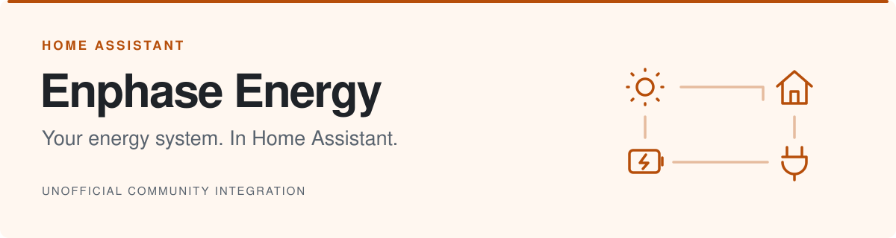
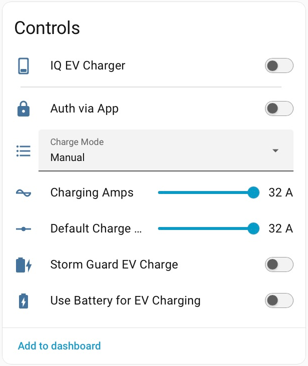
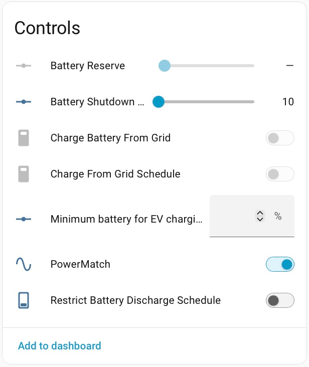
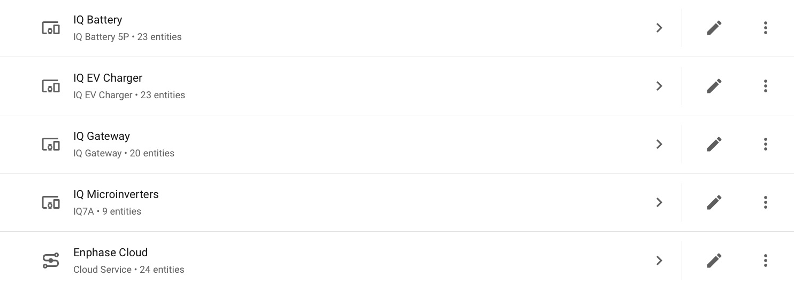
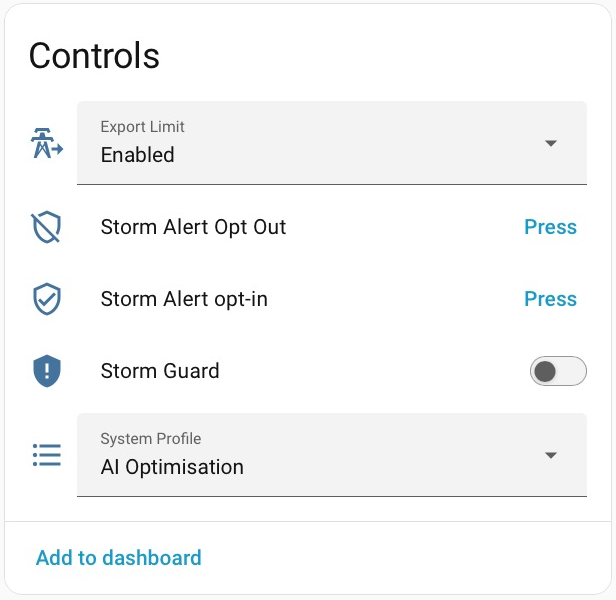
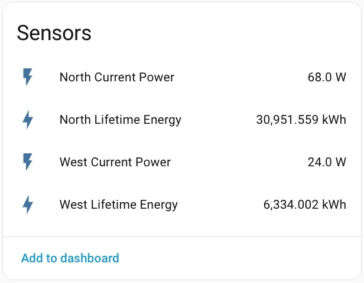
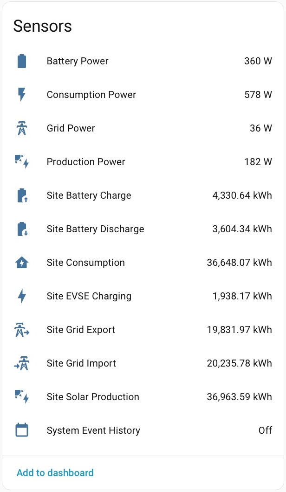
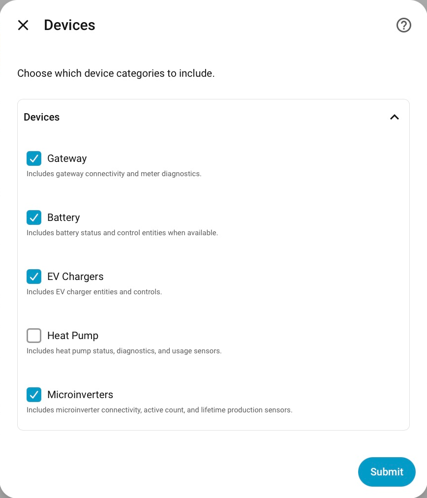

<picture>
  <source media="(prefers-color-scheme: dark)" srcset="docs/images/readme-banner-dark.svg">
  <source media="(prefers-color-scheme: light)" srcset="docs/images/readme-banner-light.svg">
  
</picture>

  
  
  

Monitor solar, batteries and charging. Control your Enphase system from Home Assistant.

  <a href="#get-started">Install</a> ·
  <a href="#at-a-glance">Screenshots</a> ·
  <a href="https://github.com/barneyonline/ha-enphase-energy/wiki">Documentation</a>

> [!IMPORTANT]
> This is an unofficial community project, not affiliated with, endorsed by, or supported by Enphase Energy. It relies on undocumented cloud APIs that may change or stop working without notice.

## At a glance

EV charging modes, current and session controls alongside battery reserve, grid charging and schedules.

<!-- Inline images wrap onto separate rows on narrow screens. Keep their natural proportions. -->

  <picture>
    <source media="(prefers-color-scheme: dark)" srcset="docs/images/charger-controls-dark.png">
    <source media="(prefers-color-scheme: light)" srcset="docs/images/charger-controls-light.png">
    
  </picture>
  &nbsp;
  <picture>
    <source media="(prefers-color-scheme: dark)" srcset="docs/images/battery-controls-dark.png">
    <source media="(prefers-color-scheme: light)" srcset="docs/images/battery-controls-light.png">
    
  </picture>

More screenshots · devices, gateway, solar and cloud

### Connected devices

<picture>
  <source media="(prefers-color-scheme: dark)" srcset="docs/images/devices-dark.png">
  <source media="(prefers-color-scheme: light)" srcset="docs/images/devices-light.png">
  
</picture>

### Gateway controls and microinverter sensors

  <picture>
    <source media="(prefers-color-scheme: dark)" srcset="docs/images/gateway-controls-dark.png">
    <source media="(prefers-color-scheme: light)" srcset="docs/images/gateway-controls-light.png">
    
  </picture>
  &nbsp;
  <picture>
    <source media="(prefers-color-scheme: dark)" srcset="docs/images/microinverters-sensors-dark.png">
    <source media="(prefers-color-scheme: light)" srcset="docs/images/microinverters-sensors-light.png">
    
  </picture>

### Cloud energy sensors

  <picture>
    <source media="(prefers-color-scheme: dark)" srcset="docs/images/cloud-sensors-dark.png">
    <source media="(prefers-color-scheme: light)" srcset="docs/images/cloud-sensors-light.png">
    
  </picture>

## Get started

1. Find **Enphase Energy** in HACS.
2. Install and restart Home Assistant.
3. Add the integration and sign in with your Enlighten credentials. MFA is supported.

Requires **Home Assistant 2026.10.0+** (Python 3.14+).

See the [Wiki](https://github.com/barneyonline/ha-enphase-energy/wiki) for installation, setup and troubleshooting.

Device selection

Choose the device categories to include. Availability depends on your site and account access.

<picture>
  <source media="(prefers-color-scheme: dark)" srcset="docs/images/setup-dark.png">
  <source media="(prefers-color-scheme: light)" srcset="docs/images/setup-light.png">
  
</picture>

Supported devices and features

### Supported device categories

- IQ Gateway / System Controller entities and controls
- IQ Battery telemetry and BatteryConfig controls (where supported)
- IQ EV Charger controls and session telemetry
- IQ Microinverter connectivity, inventory, lifetime production, and optional installer-level parameter telemetry
- Site and cloud energy telemetry (including supported HEMS channels such as Heat Pump and Water Heater lifetime energy)

### Key features

- Guided setup with site, device-category, and multi-gateway selection
- Site and battery energy monitoring for the Home Assistant Energy Dashboard
- EV charging controls, actual charging status, and session history
- Battery profiles, reserve settings, schedules, and supported PowerMatch controls
- Array monitoring and optional per-microinverter energy and power sensors
- Heat-pump status, SG-Ready mode, and energy monitoring
- Gateway and charger firmware information with release-note links
- Editable tariffs, optional installer Grid Profile controls, and OTP-confirmed Grid Mode changes
- Storm Alert controls and guided battery profile recovery through Repairs
- System events, alarms, and calendars, plus optional VPP/ELRP monitoring
- Optional site weather from Enphase
- Cloud recovery, health diagnostics, and automation actions
- User-facing strings localized in more than 20 languages

Migrating from Enphase Envoy

Users migrating from the core Enphase Envoy integration can preserve compatible Energy-dashboard history with the [Envoy History Migration](https://github.com/barneyonline/ha-enphase-energy/wiki/Envoy-History-Migration) assistant. Create a full Home Assistant backup first.

Project status

